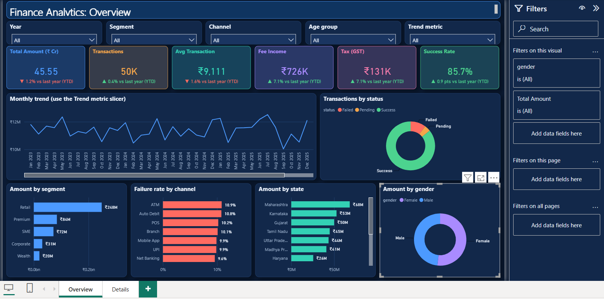
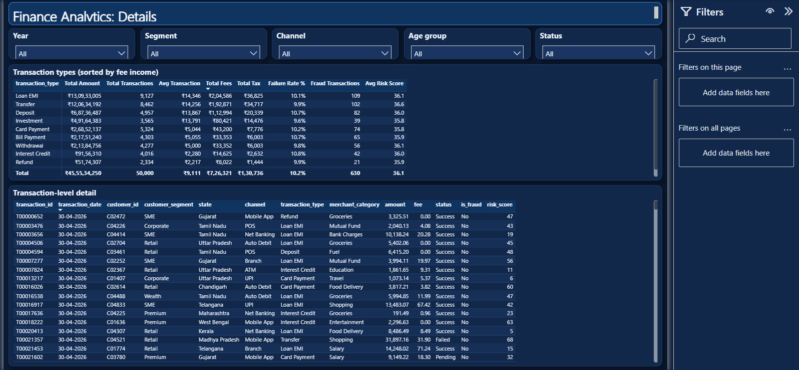

<div align="center">

# Finance Transaction Analytics
### End-to-end pipeline: Python · PostgreSQL · Power BI


**50,069 raw transactions → 50,000 verified records → 29 DAX measures → one interactive dashboard**



</div>

---

## Contents
1. [Business problem](#business-problem)
2. [Solution architecture](#solution-architecture)
3. [Data quality: what was found and fixed](#data-quality-what-was-found-and-fixed)
4. [Key insights](#key-insights)
5. [Recommendations](#recommendations)
6. [Dashboard](#dashboard)
7. [How to run](#how-to-run)
8. [Repository structure](#repository-structure)
9. [Documentation](#documentation)

---

## Business problem

A financial services company tracked transactions in separate spreadsheets. Management could not get reliable answers to basic questions:

- How are transaction **value and volume trending**, month by month and year over year?
- What share of transactions **succeed, fail or stay pending**, and **which channels fail most**?
- Which **customer segments, states and transaction types** drive value and fee income?
- Can the existing **risk score** be trusted to flag fraud?

The raw data also had quality problems that inflated totals, including duplicates, typos and negative amounts. **Goal:** build one trusted, refreshable source of truth and an interactive dashboard on top of it.

---

## Solution architecture

```mermaid
flowchart LR
    A[Raw CSV files<br/>50,069 transactions<br/>5,000 customers] --> B[Python · pandas<br/>step01 explore<br/>step02 clean & fix]
    B --> C[(PostgreSQL<br/>finance_db<br/>2 tables · 8 KPI views)]
    C --> D[Power BI<br/>Power Query + DAX<br/>2-page dashboard]
    C --> E[Excel<br/>Power Query]
    B -. cleaning_log.csv .-> F[Audit trail]
```

| Layer | Tool | What it does |
| --- | --- | --- |
| **Extract & clean** | Python (pandas, numpy) | Profiles the raw files, fixes 9 data problems with before/after counts, and runs automatic checks before loading |
| **Store & model** | PostgreSQL 18 | Typed tables with primary keys, a foreign key and a `CHECK` constraint; bulk load with `COPY`; 8 KPI views using window functions |
| **Analyse** | SQL | 9 business-question queries (JOIN, GROUP BY, HAVING, CASE, `FILTER`, `RANK`, `LAG`) |
| **Visualise** | Power BI | Star-style model, Calendar table, 29 measures, field-parameter metric switch, like-for-like YTD comparisons |

**One-command refresh:** edit the raw CSVs, run `python python/run_pipeline.py`, then click **Refresh** in Power BI.

---

## Data quality: what was found and fixed

| # | Problem in the raw data | Rows | Fix |
| --- | --- | ---: | --- |
| T1 | Exact duplicate rows (inflated value by **₹7.46 L**) | 68 | Removed |
| T2 | Same transaction ID twice, one copy missing its fee | 1 | Kept the complete copy |
| T3 | Channel typos and stray spaces (`M@bile App`, `  POS`) | 770 | Trimmed and corrected |
| T4 | Currency in mixed case (`inr`, `inR`) | 605 | Upper-cased |
| T5 | Blank fee amounts | 23 | Rebuilt from tax, using the **18% GST rule** discovered in the data |
| T6 | Negative amounts (sign-entry errors) | 8 | Made positive, flagged in `amount_was_negative` |
| T7 | Dates stored as text (`dd-mm-yyyy`) | 50,000 | Converted, with year and month columns added |
| C1 | Column-name typo `fisrt_name` | 5,000 | Renamed |
| C2 | Customer dates stored as text | 5,000 | Converted, with age derived |

Every fix is written to [`data/clean/cleaning_log.csv`](data/clean/cleaning_log.csv). The pipeline stops if any check fails: unique IDs, no blank fees, no negative amounts, every customer known. The full method is in the [Data quality report](docs/03_data_quality_report.md).

---

## Key insights

| Area | Finding |
| --- | --- |
| **Scale** | **₹45.55 Cr** across **50,000** transactions (average **₹9,111**); fees ₹7.26 L, tax ₹1.31 L |
| **Status** | **85.7%** success · **10.2%** failed · **4.1%** pending. Failed transactions represent **₹4.75 Cr** of value |
| **Channels** | **ATM (10.9%)** and **Auto Debit (10.8%)** fail most; **Net Banking (9.6%)** least |
| **Customers** | **Retail** brings **54.5%** of value; Premium 18.5%, SME 15.8% |
| **Regions** | **Maharashtra (15.0%)**, Karnataka (11.6%) and Gujarat (11.0%) lead |
| **Fee income** | **Loan EMI (28.2%)** and **Transfers (26.6%)** generate over half of all fees |
| **Fraud** | Fraud-flagged transactions average a **risk score of 82.9**, against **35.5** for normal ones. A threshold of 70 catches **85% of fraud** (535 of 630) |
| **Trend** | Value is stable year on year (2024 −1.1%, 2025 +1.4%). Jan–Apr 2026 is 1.2% below Jan–Apr 2025 |

Full analysis: [Insights and recommendations](docs/06_insights_and_recommendations.md).

---

## Recommendations

1. **Cut failures, starting with ATM and Auto Debit.** Each 1-point reduction in the failure rate protects roughly ₹45 L of transaction value.
2. **Turn the risk score into a live alert.** Flagging scores ≥ 70 would review about 2.4% of transactions and catch 85% of fraud.
3. **Protect the Retail segment** with retention offers, since it carries over half the value.
4. **Review pricing on Loan EMI and Transfers**, the two products that drive fee income.

---

## Dashboard

Two pages, fully interactive: **slicers** (Year, Segment, Channel, Age group), a **Trend metric** switch (Amount / Transactions / Fees / Tax), **click-to-filter** on every visual, and **YoY (YTD)** labels that turn green or red.

| Overview | Details |
| --- | --- |
|  |  |

The report is saved as a **Power BI Project (`.pbip`)**, which is plain text. You can read every measure on GitHub in [`_Measures.tmdl`](FInance_analysis.SemanticModel/definition/tables/_Measures.tmdl). See the [Power BI model guide](docs/05_power_bi_model.md).

---

## How to run

**Requirements:** Python 3.10+, PostgreSQL (with pgAdmin) and Power BI Desktop (the free version is enough).

```bash
git clone https://github.com/ravindraushi14-rock/finance-analytics-python-sql-powerbi.git
cd finance-analytics-python-sql-powerbi
pip install -r requirements.txt
python python/run_pipeline.py      # asks for your PostgreSQL password once; creates finance_db
```

Then open **`FInance_analysis.pbip`**, sign in to PostgreSQL (`localhost` / `finance_db`) and click **Refresh**. Step-by-step help is in [`powerbi/power_bi_setup.md`](powerbi/power_bi_setup.md).

> The password is never stored in code. It is read from the `PG_PASSWORD` environment variable, or asked for at run time.

---

## Repository structure

```
├── data/
│   ├── raw/                        original CSVs (never modified by code)
│   └── clean/cleaning_log.csv      audit trail of every fix
├── python/
│   ├── config.py                   paths + PostgreSQL connection settings
│   ├── step01_load_and_explore.py  profile the raw data, list the problems
│   ├── step02_clean.py             one function per fix, final checks
│   ├── step03_load_to_sql.py       create finance_db, COPY data, build views
│   ├── step04_analysis.py          insights, charts, CSV copies of the views
│   └── run_pipeline.py             runs steps 01 → 04
├── sql/
│   ├── 01_create_tables.sql        tables, keys, constraints, indexes
│   ├── 02_kpi_views.sql            8 KPI views
│   └── 03_analysis_queries.sql     9 business questions
├── FInance_analysis.pbip           Power BI project (open this)
├── FInance_analysis.Report/        report pages and visuals (text)
├── FInance_analysis.SemanticModel/ tables, relationships, DAX measures (text)
├── powerbi/                        setup guide + Power Query (M) script
├── outputs/charts/                 dashboard screenshots + Python charts
├── docs/                           project documentation (see below)
└── requirements.txt
```

---

## Documentation

| Document | Contents |
| --- | --- |
| [01 Business requirements](docs/01_business_requirements.md) | Objectives, stakeholders, KPI definitions, scope |
| [02 Data dictionary](docs/02_data_dictionary.md) | Every column in the raw files, clean tables and the reporting view |
| [03 Data quality report](docs/03_data_quality_report.md) | Profiling results, each fix and its reasoning, validation checks |
| [04 SQL guide](docs/04_sql_guide.md) | Schema design, the 8 views and the 9 analysis queries explained |
| [05 Power BI model](docs/05_power_bi_model.md) | Data model, measure catalogue, YTD logic, page design |
| [06 Insights and recommendations](docs/06_insights_and_recommendations.md) | Findings with figures and the actions they support |

---

<div align="center">

**Ravindra Narsayya Ushi** · Operations MIS & Data Analytics · 16+ years turning operational data into decisions

[LinkedIn](https://www.linkedin.com/in/ravindra-narsayya-ushi-465762302) · [GitHub](https://github.com/ravindraushi14-rock)

</div>
