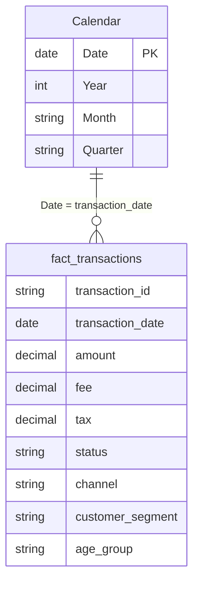

# 05 · Power BI Model

The dashboard is saved as a **Power BI Project** (`FInance_analysis.pbip`). Report pages, visuals, tables and every DAX measure are stored as readable text files, so changes can be tracked in Git.

## 1. Data model


| Table | Source | Purpose |
| --- | --- | --- |
| `fact_transactions` | PostgreSQL view `v_fact_transactions` (Import mode) | One row per transaction, with customer attributes |
| `Calendar` | DAX `CALENDAR()`, from 1 Jan of the first year to the last transaction date | Marked as the date table; drives the YTD logic |
| `_Measures` | Calculated table | Holds all 29 measures, in display folders |
| `Metric Selector` | **Field parameter** | Switches the trend chart between Amount, Transactions, Fees and Tax |

**Power Query (M):** connects with `PostgreSQL.Database("localhost", "finance_db")` and sets the data type of every column. Source: [`fact_transactions.tmdl`](../FInance_analysis.SemanticModel/definition/tables/fact_transactions.tmdl).

## 2. Measure catalogue (29 measures)
| Folder | Measures |
| --- | --- |
| **Core** | Total Amount, Total Amount (Cr), Total Transactions, Avg Transaction, Total Fees, Total Tax |
| **Status** | Success Rate %, Failure Rate %, Pending Rate % |
| **Risk** | Fraud Transactions, Avg Risk Score |
| **Growth** | Amount / Transactions / Avg Transaction / Fees / Tax YoY % (YTD), Success Rate Change (YTD) |
| **Growth › Card labels** | 6 × YoY label (`▲ 1.4% vs last year (YTD)`) and 6 × colour (green / red) for conditional formatting |

All measures: [`_Measures.tmdl`](../FInance_analysis.SemanticModel/definition/tables/_Measures.tmdl).

## 3. Like-for-like YTD comparison
The data ends on 30 Apr 2026. A plain "this year vs last year" comparison would set 4 months against 12, so every YoY measure compares the **same date range**:

```DAX
Amount YoY % (YTD) =
VAR _LastDay   = MAX(fact_transactions[transaction_date])
VAR _YearStart = DATE(YEAR(_LastDay), 1, 1)
VAR _Cur  = CALCULATE([Total Amount], REMOVEFILTERS('Calendar'),
                      DATESBETWEEN('Calendar'[Date], _YearStart, _LastDay))
VAR _Prev = CALCULATE([Total Amount], REMOVEFILTERS('Calendar'),
                      DATESBETWEEN('Calendar'[Date], EDATE(_YearStart, -12), EDATE(_LastDay, -12)))
RETURN DIVIDE(_Cur - _Prev, _Prev)
```
Selecting **2025** compares all of 2025 with 2024. Selecting **All** or **2026** compares Jan–Apr 2026 with Jan–Apr 2025.

## 4. Report pages
| Page | Visuals |
| --- | --- |
| **Overview** | Title · 5 slicers (Year, Segment, Channel, Age group, Trend metric) · 6 KPI cards with dynamic YoY labels · monthly trend (field parameter) · status donut · amount by segment · failure rate by channel · amount by state · amount by gender |
| **Details** | 5 slicers · transaction-type matrix (value, count, fees, tax) · transaction-level table |

**Design:** custom dark theme (`FinanceTheme.json`); a consistent colour per status (success green, failed red, pending amber); every visual cross-filters the others.

## 5. Refresh
`python python/run_pipeline.py` → Power BI **Home → Refresh**. Setup help: [`powerbi/power_bi_setup.md`](../powerbi/power_bi_setup.md).
